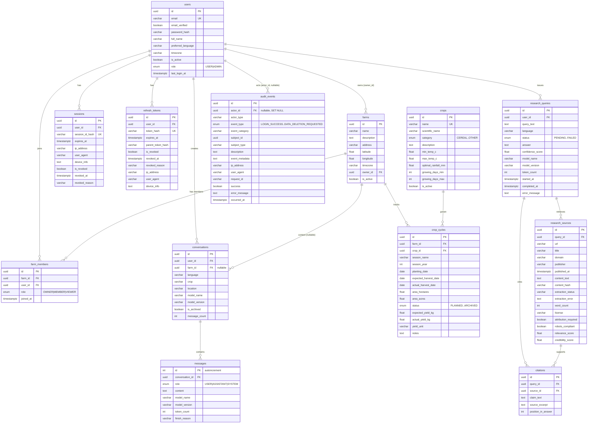

# MyFarm AI — Database Schema Reference

**Version:** 0.1.0
**Date:** 2026-10-28
**Schema source:** Alembic migration `6cd2bffd9881_initial_schema.py` (authoritative)
**Databases:** PostgreSQL 17 (production target), SQLite (tests only)

---

## ER Diagram

---

## Delete Semantics (FK on-delete)

| Relationship | On delete | Rationale |
|--------------|-----------|-----------|
| user → conversations | CASCADE | User deletion removes their chat history (privacy) |
| user → farms (owner) | CASCADE | Owner deletion removes owned farms |
| user → farm_members | CASCADE | Membership ends with the user |
| user → sessions / refresh_tokens | CASCADE | Auth state dies with the user |
| user → research_queries | CASCADE | Research history dies with the user |
| user → audit_events (actor) | SET NULL | Audit trail survives the actor (compliance) |
| conversation → messages | CASCADE | Messages cannot outlive their conversation |
| farm → conversations | SET NULL | Conversations survive farm deletion, lose farm context |
| farm → crop_cycles | CASCADE | Cycles are farm-scoped |
| crop → crop_cycles | RESTRICT | Prevent deleting a crop in active use |
| research_query → sources / citations | CASCADE | Provenance is query-scoped |
| research_source → citations | CASCADE | Citations die with their source |

---

## Data Dictionary — Core Tables

### users
| Column | Type | Constraints | Notes |
|--------|------|-------------|-------|
| id | UUID | PK, default `gen_random_uuid()` | |
| email | varchar(255) | NOT NULL, UNIQUE (indexed) | Login identifier |
| email_verified | boolean | NOT NULL | |
| password_hash | varchar(255) | NOT NULL | Argon2id (Phase 3) |
| full_name | varchar(255) | nullable | |
| preferred_language | varchar(10) | NOT NULL | ISO 639-1, e.g. `en`, `hi` |
| timezone | varchar(50) | NOT NULL | IANA name, e.g. `Asia/Kolkata` |
| is_active | boolean | NOT NULL | Soft-disable flag |
| role | varchar enum | NOT NULL | `USER` \| `ADMIN` (native_enum=false) |
| last_login_at | timestamptz | nullable | |
| created_at / updated_at | timestamptz | NOT NULL, default `now()` | |

Indexes: `ix_users_email` (unique), `ix_users_email_active`, `ix_users_role`.

### conversations
| Column | Type | Constraints | Notes |
|--------|------|-------------|-------|
| id | UUID | PK | |
| user_id | UUID | NOT NULL, FK → users ON DELETE CASCADE | Owner |
| farm_id | UUID | nullable, FK → farms ON DELETE SET NULL | Optional farm context |
| language | varchar(10) | NOT NULL | `en` \| `hi` observed |
| crop | varchar(100) | nullable | Crop context for the chat |
| location | varchar(200) | nullable | Location context |
| model_name / model_version | varchar(100) | nullable | Model metadata |
| is_archived | boolean | NOT NULL | |
| message_count | int | NOT NULL | Denormalized; kept consistent by service layer |
| created_at / updated_at | timestamptz | NOT NULL | |

Indexes: `ix_conversations_user_id`, `ix_conversations_user_updated`, `ix_conversations_user_farm`, `ix_conversations_farm_id`, `ix_conversations_farm_updated`.

### messages
| Column | Type | Constraints | Notes |
|--------|------|-------------|-------|
| id | int | PK, autoincrement | Integer PK by design (ordered append log) |
| conversation_id | UUID | NOT NULL, FK → conversations ON DELETE CASCADE | |
| role | varchar enum | NOT NULL | `USER` \| `ASSISTANT` \| `SYSTEM` |
| content | text | NOT NULL | |
| model_name / model_version | varchar(100) | nullable | Populated for ASSISTANT rows |
| token_count | int | nullable | |
| finish_reason | varchar(50) | nullable | e.g. `stop`, `length` |
| created_at / updated_at | timestamptz | NOT NULL | |

Indexes: `ix_messages_conversation_id`, `ix_messages_conversation_created`.

---

## Migration Transform Rules (SQLite legacy → PostgreSQL)

Recorded for the Phase 2 rehearsal (P2-24); implemented in
`backend/scripts/migrate_sqlite_to_pg.py`:

1. **Source:** canonical `backend/data/app.db`, opened read-only; SHA-256 recorded in the export manifest.
2. **Ownership:** all legacy conversations are assigned to a single `legacy_import` user — nil UUID `00000000-0000-0000-0000-000000000000`, email `legacy_import@myfarmai.internal`, `is_active=false`, unusable password hash. No real user is impersonated.
3. **IDs:** legacy conversation IDs are already UUID v4 strings and are preserved as-is; message integer IDs are preserved.
4. **Timestamps:** legacy SQLite timestamps are naive (`CURRENT_TIMESTAMP` = UTC). They are parsed as UTC and stored as `TIMESTAMPTZ` at UTC.
5. **Roles:** legacy lowercase `user`/`assistant` are upper-cased and validated against `{USER, ASSISTANT, SYSTEM}`.
6. **Derived data:** `conversations.message_count` is recomputed from messages during transform.
7. **Load:** single transaction; `COPY ... FROM STDIN`; refuses to run if the target `conversations` table is non-empty.
8. **Validation:** row counts, per-conversation message counts, orphan check, `message_count` column consistency, role domain check (P2-26).

---

*Schema reference reflects Alembic migration `6cd2bffd9881` as of 2026-10-28.*
