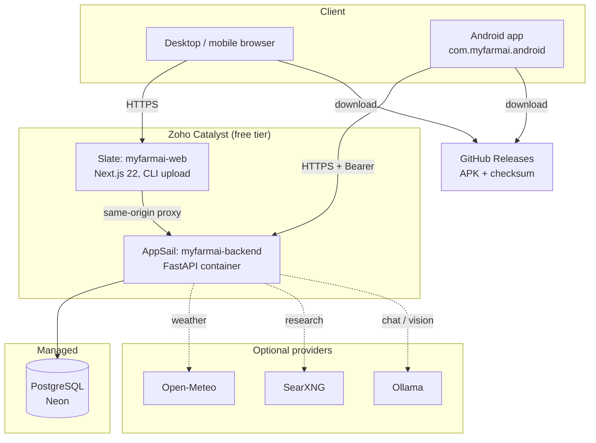

# MyFarmAI — Production Architecture

**Document ID:** MYFARMAI-DEP-010
**Version:** 1.0
**Date:** 2026-11-11
**Applies to:** v1.0.0

## 1. Topology

## 2. Components

| Layer | Technology | Host | Public hostname | State |
|---|---|---|---|---|
| Web frontend | Next.js (App Router), React, Tailwind | Zoho Catalyst Slate, Node 22 | `myfarmai-web-zwpytbwu.onslate.in` | Live, **stale bundle** |
| API | FastAPI (Python 3.12), SQLAlchemy async | Zoho Catalyst AppSail (container) | `myfarmai-backend-50047414881.development.catalystappsail.in` | Live, image `prod-c63d3963-v2` (2026-11-10) |
| Database | PostgreSQL | Neon (managed) | private, TLS | Live; `/health/ready` reports `database: ok` |
| AI | Ollama gateway, `qwen3:4b` default, `qwen3-vl:2b` vision | none in production | n/a | **Disabled in the live deployment** (`ollama: disabled`) |
| Weather | Open-Meteo forecast API | external | `api.open-meteo.com` | Free tier, **non-commercial only** |
| Research | SearXNG | none in production | n/a | Not deployed with the live API |
| APK distribution | GitHub Releases + backend `PUBLIC_DIR` | GitHub / AppSail | `releases/download/v1.0.0/app-release.apk` | Live, checksum verified |
| CI | GitHub Actions | GitHub | n/a | `ci.yml` (PR), `release.yml` (tag) |

## 3. Request paths

**Web → API.** The browser talks to the Next.js origin only. Next.js rewrites
`/api/*` to the AppSail origin, so the session cookie stays first-party and no CORS
preflight is needed for the app. `NEXT_PUBLIC_API_BASE_URL` is set in `web/.env.local`.

**Android → API.** The app calls the AppSail origin directly with
`Authorization: Bearer <session-id>` and a single-use refresh token. No cookie is used.

**Authentication.** Opaque server-side sessions. Web: `HttpOnly`, `SameSite=Lax`,
`Secure` in production. Android: bearer session id + rotating refresh token with reuse
detection. Passwords: Argon2id. The 2026-11-11 fix makes the OTP verify step set the
password (`6976a3f`), which the live image does not yet contain.

## 4. Data ownership and isolation

- Every farm, plot, crop cycle and crop plan is scoped to a farm the caller owns or is a
  member of; the API resolves authorization server-side on each request.
- Conversations are scoped to the creating user.
- Selfie verification files are re-encoded (EXIF stripped) into a `0700` server-internal
  directory; no path, filename or URL is returned to any client.
- No client receives a database credential. There is no public database port.

## 5. Failure behaviour (degrade, do not destroy)

| Dependency down | Expected behaviour | Verified |
|---|---|---|
| Ollama / model | Chat returns 503 `AI_BUSY` / 504 timeout; saved farms, plans and history remain readable | Backend tests (mocked provider) |
| Open-Meteo | Weather endpoint surfaces an error state; dashboard still loads from the database | Backend tests |
| SearXNG | `503 RESEARCH_UNAVAILABLE`; assistant still answers without citations | Backend tests |
| Database | `/health/ready` reports failure; API returns 5xx; no partial writes | Readiness probe only |
| GitHub Releases | `/download` page still renders; the APK link fails at GitHub | By construction (static page) |

## 6. Resource envelope

| Resource | Limit | Consequence |
|---|---|---|
| AppSail container | free-tier CPU/RAM | Slow first response after idle; AI inference is not viable here |
| Neon free tier | storage + compute hours | Sufficient for v1.0.0 synthetic-test volumes; not for real farmer data at scale |
| Slate | static/SSR hosting | No persistent filesystem |
| GitHub Releases | 2 GiB per asset | APK is 64.7 MiB — fine |

## 7. Known architectural gaps

1. **No deployment link.** The Slate app is `app_type: cli` with `auto_deploy: false` and
   no Git binding. Deploying requires the Catalyst CLI from an authenticated machine.
   This host has neither the CLI nor credentials.
2. **AI has no production host.** The architecture assumes a server-side Ollama. No such
   host exists in the live deployment, so chat and research are non-functional there.
3. **Email delivery has no provider.** `EMAIL_DELIVERY_MODE=dev` writes codes to a
   server-side file. Public registration therefore cannot complete.
4. **No object storage.** The APK is served from `PUBLIC_DIR` and GitHub; there is no
   user-upload store beyond the verification directory on the container filesystem,
   which is not durable across redeploys.
5. **Single region, no HA.** Acceptable for a free-tier test release; documented, not hidden.

## 8. What would make this production-grade

- A Git-linked deploy pipeline (or a CI job holding a Catalyst token) so the deployed
  bundle always matches `main`.
- An AI host with enough RAM for a quantised model, or a documented decision that the
  hosted build ships without AI.
- A transactional email provider on a free tier.
- Durable object storage for uploads.
- Automated database backups with a restore drill.
