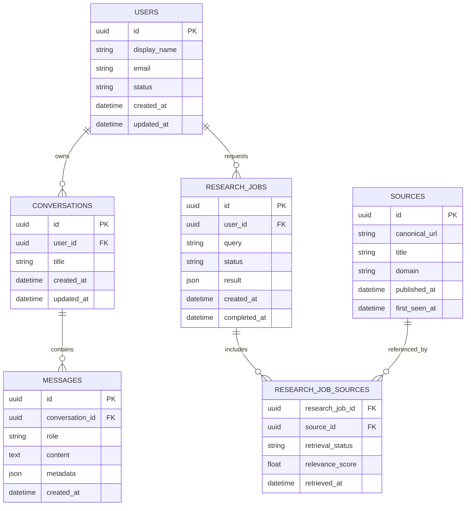

# MyFarmAI — Backend Schema Document

**Document ID:** MYFARMAI-BACKEND-SCHEMA-001  
**Version:** 1.0  
**Status:** Draft — Owner Review Required  
**Scope:** Backend data model and API schema proposal  
**Related documents:** PRD, TRD, APP_FLOW, approved SRS and ADRs

> **Important governance constraint:** This document proposes a logical schema. It does not authorize creating tables, changing existing schemas, moving, merging, deleting, or migrating databases. The canonical SQLite location (`backend/data/app.db` versus `data/app.db`) remains unresolved in the current project context. PostgreSQL is a proposed target, not permission to replace or migrate existing data. Inspect the repository and obtain the required owner approvals before implementation.

## 1. Purpose

Define the proposed backend data entities, relationships, API payload shapes, validation rules, and persistence boundaries for MyFarmAI.

The schema must be reconciled with the existing codebase, SRS, reviewed ADRs, and actual data before it is treated as authoritative.

## 2. Schema Design Principles

- Model only approved product capabilities.
- Keep persistent data separate from transient request state.
- Use stable identifiers and explicit relationships.
- Enforce integrity in the database where appropriate.
- Validate all incoming data at the API boundary.
- Store source provenance for research results.
- Never fabricate source metadata.
- Avoid storing secrets in application tables.
- Minimize personal data and define retention rules before persisting user content.
- Use migrations only after review and authorization.
- Do not silently create a second canonical database.

## 3. Proposed Logical Entities

The following entities are candidates. Inclusion in the final schema depends on approved product scope.

| Entity | Purpose | Status |
|---|---|---|
| `users` | Account identity and account metadata, if authentication is approved | Conditional |
| `conversations` | Group a user's question-and-answer interactions, if history is approved | Conditional |
| `messages` | Store user questions and assistant responses, if persistence is approved | Conditional |
| `research_jobs` | Track research work if asynchronous processing is approved | Conditional |
| `sources` | Store metadata for sources actually discovered or retrieved | Proposed |
| `research_job_sources` | Associate source records with a research job and retrieval status | Conditional |
| `model_providers` | Non-secret provider configuration metadata, if provider administration is in scope | Conditional |
| `audit_events` | Security-relevant administrative events, subject to a retention policy | Conditional |

Do not create these tables solely because they appear in this document.

## 4. Entity Relationship Diagram



This diagram is conceptual. Exact columns, constraints, types, and relationships must be verified against the approved requirements and existing schema.

## 5. Proposed Field Specifications

### 5.1 `users` — conditional

| Field | Suggested type | Rules |
|---|---|---|
| `id` | UUID | Primary key |
| `display_name` | VARCHAR(120) | Optional unless product requirements make it mandatory |
| `email` | VARCHAR(320) | Required only if email-based accounts are approved; normalized and uniquely constrained |
| `password_hash` | VARCHAR | Only for an approved password-based authentication method; never store plaintext passwords |
| `status` | VARCHAR or enum | Approved status values only |
| `created_at` | UTC timestamp | Set by the server |
| `updated_at` | UTC timestamp | Updated on changes |

Do not store raw passwords, access tokens, recovery secrets, or provider credentials in this table.

### 5.2 `conversations` — conditional

| Field | Suggested type | Rules |
|---|---|---|
| `id` | UUID | Primary key |
| `user_id` | UUID | Foreign key when user accounts are enabled |
| `title` | VARCHAR(200) | Optional; derived safely from content if permitted |
| `created_at` | UTC timestamp | Server-generated |
| `updated_at` | UTC timestamp | Server-generated |

Access to a conversation must be checked server-side. A client-supplied identifier is not proof of ownership.

### 5.3 `messages` — conditional

| Field | Suggested type | Rules |
|---|---|---|
| `id` | UUID | Primary key |
| `conversation_id` | UUID | Foreign key |
| `role` | VARCHAR or enum | Allow only defined roles such as `user` and `assistant`; other roles require explicit design |
| `content` | TEXT | Apply length limits and a documented retention policy |
| `metadata` | JSON/JSONB | Optional, validated, and free of secrets |
| `created_at` | UTC timestamp | Server-generated |

Define deletion, retention, and export behavior before storing conversation content. Avoid logging message content unnecessarily.

### 5.4 `research_jobs` — conditional

Use this entity only if research requests are asynchronous or require persisted status/history.

| Field | Suggested type | Rules |
|---|---|---|
| `id` | UUID | Primary key |
| `user_id` | UUID | Nullable only if anonymous use is explicitly approved |
| `query` | TEXT | Length-limited; retention policy required |
| `status` | VARCHAR or enum | Suggested states: `queued`, `running`, `completed`, `partial`, `failed`, `cancelled` |
| `result` | JSON/JSONB | Validated result structure; avoid duplicate unbounded payloads |
| `error_code` | VARCHAR | Safe machine-readable error code, not stack trace |
| `created_at` | UTC timestamp | Server-generated |
| `completed_at` | UTC timestamp | Nullable until terminal state |

The final status transitions must be specified and tested. Do not add background-job infrastructure unless approved scope requires it.

### 5.5 `sources` — proposed

| Field | Suggested type | Rules |
|---|---|---|
| `id` | UUID | Primary key |
| `canonical_url` | TEXT | Validated URL; unique constraint strategy requires review |
| `title` | TEXT | Nullable if unavailable |
| `domain` | VARCHAR(255) | Derived from validated URL |
| `published_at` | UTC timestamp | Nullable; do not invent unknown dates |
| `first_seen_at` | UTC timestamp | Server-generated |

A source row must not imply that the source was successfully fetched. Retrieval status belongs to the retrieval/job association or another explicit retrieval record.

### 5.6 `research_job_sources` — conditional

| Field | Suggested type | Rules |
|---|---|---|
| `research_job_id` | UUID | Foreign key |
| `source_id` | UUID | Foreign key |
| `retrieval_status` | VARCHAR or enum | Examples: `discovered`, `success`, `blocked`, `timeout`, `failed`, `unsupported` |
| `relevance_score` | Numeric | Nullable; define scoring scale and algorithm |
| `retrieved_at` | UTC timestamp | Nullable if retrieval did not succeed |
| `error_code` | VARCHAR | Optional safe error category |

Suggested composite key: (`research_job_id`, `source_id`). Confirm whether multiple retrieval attempts per source must be represented separately.

### 5.7 `model_providers` — conditional

Persist only non-secret configuration metadata if provider management is approved. Examples include provider type, enabled state, model identifier, and safe operational limits.

Credentials must be provided through the approved secret-management mechanism, not stored as plaintext in this table. Do not silently configure external providers or fallback destinations.

### 5.8 `audit_events` — conditional

Potential fields include event ID, actor reference where available, action, target type, target identifier, timestamp, outcome, and a redacted metadata object.

Do not store passwords, tokens, or unnecessary personal content. Define access controls and retention before enabling audit persistence.

## 6. Data Types and Cross-Database Compatibility

- Use UUIDs or another approved stable identifier format consistently.
- Store timestamps in UTC and serialize them as ISO 8601 with an explicit timezone.
- Use `JSONB` on PostgreSQL where justified; use compatible JSON handling for SQLite tests only where the current implementation requires it.
- Define enum constraints in a way supported by the selected database and migration strategy.
- Avoid database-specific behavior in business logic when portability is required.
- Do not assume PostgreSQL and SQLite have identical transaction, type, constraint, or concurrency behavior.

The final types must be chosen based on the approved database decision and actual codebase.

## 7. API Schema Proposals

These are illustrative contracts, not claims about existing endpoints.

### 7.1 Ask an agricultural question

Candidate endpoint: `POST /api/v1/ai/answer`

Request:

```json
{
  "question": "What are common signs of nitrogen deficiency in wheat?",
  "language": "en",
  "include_sources": true
}
```

Response:

```json
{
  "answer": "Answer grounded in available evidence.",
  "sources": [],
  "limitations": [],
  "request_id": "server-generated-correlation-id"
}
```

Requirements:
- Validate the question length and supported parameters.
- Define whether requests are authenticated or anonymous.
- Return only actual source records.
- Distinguish full results from partial results.
- Apply request timeouts and concurrency limits.

### 7.2 Start research

Candidate endpoint: `POST /api/v1/research`

Request:

```json
{
  "query": "Sustainable irrigation methods for small farms",
  "language": "en"
}
```

A synchronous API may return the final result. An asynchronous design may return a job identifier and status. The project must select one approach based on the existing implementation and approved requirements; do not implement both by assumption.

### 7.3 Research status

Candidate endpoint: `GET /api/v1/research/{id}`

Use only if asynchronous research jobs are approved. Verify ownership or authorization on every request.

## 8. Validation Rules

- Reject missing or blank required fields.
- Enforce documented maximum lengths.
- Reject unsupported enum values.
- Validate URLs and enforce SSRF defenses before network retrieval.
- Validate JSON metadata against an explicit schema.
- Do not trust client-supplied user IDs, role values, ownership, timestamps, or retrieval status.
- Normalize email addresses according to the approved identity design.
- Apply pagination limits to list endpoints.
- Use consistent error codes and avoid exposing internal database details.

## 9. Indexing and Constraints

Candidate constraints, subject to query-pattern review:

- Primary keys on all persisted entities.
- Unique normalized email if email-based accounts are approved.
- Foreign keys for all approved relationships.
- Indexes on frequently filtered ownership and creation-time columns.
- Indexes for research-job status and creation time if asynchronous jobs are implemented.
- A reviewed uniqueness strategy for canonical source URLs.
- Check constraints for valid statuses where supported.

Indexes must be justified by real query patterns. Avoid indexing every column by default.

## 10. Retention and Privacy

Before storing user questions, conversations, research queries, or audit records, define:

- Why the data is stored.
- Whether it is associated with a user.
- Who can access it.
- How long it is retained.
- How it can be deleted or exported where required.
- Whether content is sent to an external model or search provider.
- Which fields are excluded from logs.

Do not enable conversation history or account-related persistence merely because the proposed entities exist.

## 11. Migration and Data Safety

Any schema change must have a version-controlled migration, review, test plan, and recovery strategy.

Mandatory safeguards:
1. Inspect the existing SQLite files and repository configuration without modifying them.
2. Resolve the canonical database location with the owner.
3. Review the required ADRs and scope approval.
4. Verify the backup and recovery process at `/data/MyFarmAI-backups`.
5. Test migrations against disposable data first.
6. Obtain explicit approval before migration or changes to persistent environments.
7. Never delete, overwrite, merge, or relocate a database as an inferred cleanup step.

A successful migration command alone is not evidence of data integrity. Validate record counts, constraints, representative queries, and restoration behavior where applicable.

## 12. Testing Requirements

- Schema validation tests.
- Required-field and boundary-length tests.
- Foreign-key and uniqueness tests.
- Transaction rollback tests.
- Ownership and authorization tests, if accounts exist.
- Research source provenance and status tests.
- Serialization tests for timestamps and JSON fields.
- Migration tests on disposable databases.
- SQLite/PostgreSQL compatibility tests if both are supported.
- Retention and deletion tests for persisted user content.
- Security tests for malformed input and unsafe URLs.

Record actual test outcomes. Do not claim tests passed without running them.

## 13. Open Decisions

The following require repository inspection or owner approval:

- Canonical database location: `backend/data/app.db` or `data/app.db`.
- Final persistence engine and migration strategy.
- Whether user accounts are in scope.
- Whether conversation history is persisted.
- Whether research is synchronous or asynchronous.
- Final source deduplication and retrieval-attempt model.
- Retention and deletion policy.
- Final reviewed ADRs and approved Phase 1 scope.
- Backup and recovery verification.
- Whether provider configuration is persisted or supplied entirely through runtime configuration.

## 14. Acceptance Criteria

This schema is ready for implementation only when:
- It is reconciled with the existing database and codebase.
- Each entity is mapped to an approved requirement.
- Conditional entities are explicitly approved or excluded.
- Field types, constraints, relationships, and indexes are reviewed.
- API schemas match the approved API contract.
- Retention and privacy requirements are defined.
- Migration and rollback plans are reviewed.
- Owner approval gates are satisfied.

**Document status:** Draft — Owner Review Required.  
**Phase 1 authorization:** Not granted by this document.  
**Database migration authorization:** Not granted by this document.
