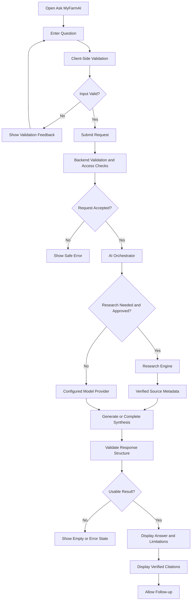

# MyFarmAI — Agricultural Question-and-Answer Flow

**Document ID:** MYFARMAI-FLOW-002  
**Version:** 1.0  
**Status:** Draft — Owner Review Required  
**Related documents:** `PRD.md`, `TRD.md`, `APP_FLOW.md`, approved SRS and ADRs

## 1. Purpose

Define the user journey and service interactions for submitting an agricultural question and displaying the resulting answer.

The flow is a proposed contract. Existing API schemas and approved requirements must be reviewed before implementation.

## 2. User Flow



## 3. Request Lifecycle

1. The user enters a question.
2. The client performs basic usability validation.
3. The client sends the request to the approved API endpoint.
4. The backend validates the request schema and applies authorization and rate limits.
5. The application service determines the permitted processing path.
6. The AI orchestrator calls the configured provider.
7. When research is required and enabled, the research engine returns retrieved source metadata and retrieval status.
8. The response is normalized and checked for valid structure.
9. The API returns the answer, citations, limitations, and request identifier according to the approved schema.
10. The client renders the result and supports a follow-up question.

## 4. Proposed API Contract

Candidate endpoint: `POST /api/v1/ai/answer`

Illustrative request:

```json
{
  "question": "What are common signs of nitrogen deficiency in wheat?",
  "language": "en",
  "include_sources": true
}
```

Illustrative response:

```json
{
  "answer": "Answer grounded in available evidence.",
  "sources": [],
  "limitations": [],
  "request_id": "server-generated-correlation-id"
}
```

These examples are not proof that this endpoint or schema exists. Confirm them against the repository and approved API specification before implementation. Real citations must come from actual retrieved or verified source records.

## 5. UI States

| State | Expected behavior |
|---|---|
| Idle | Accept a question |
| Validating | Check required input |
| Submitting | Indicate request submission |
| Processing | Indicate that AI or research is in progress |
| Success | Show a usable answer |
| Partial | Show available results and explain relevant missing evidence |
| Empty | Explain that no usable answer was returned |
| Error | Show a safe message and correlation ID when available |
| Cancelled | Show cancellation only if cancellation is supported |

## 6. Safety and Quality Requirements

- Never fabricate citations, URLs, publication dates, quotations, or source claims.
- Distinguish model-generated synthesis from retrieved evidence where relevant.
- Communicate uncertainty and limitations, especially for high-impact agricultural advice.
- Do not present a model answer as a guaranteed outcome.
- Treat retrieved content as untrusted input.
- Apply request limits, provider timeouts, and bounded concurrency.
- Do not silently transmit private questions to an unapproved external provider.
- Avoid duplicate submissions and unsafe retries.
- Do not log sensitive prompts by default.

## 7. Error Handling

| Failure | Expected behavior |
|---|---|
| Invalid input | Return a validation error |
| Unauthorized request | Reject using the approved access policy |
| Rate limit reached | Return a controlled rate-limit response |
| AI provider unavailable | Explain that an answer could not be generated |
| Research partially fails | Return a partial result only if it is valid and clearly marked |
| No usable answer | Show an empty-result state |
| Unexpected failure | Return a safe error and correlation identifier |

## 8. Acceptance Criteria

- Valid questions follow the approved processing path.
- Invalid requests are rejected consistently.
- Responses match the documented schema.
- Citations refer to actual source records.
- Partial results and failures are distinguishable from full success.
- Follow-up behavior respects the approved persistence and privacy policy.
- Tests cover success, validation, timeout, provider failure, and citation integrity.

## 9. Governance Notes

- Confirm the approved agriculture feature scope before adding specialized crop or disease workflows.
- Do not add medical-like certainty or unsupported pesticide/fertilizer prescriptions.
- Do not modify database locations or perform migrations without owner approval.
- Update this document when API behavior changes.

**Status:** Draft — Owner Review Required.
