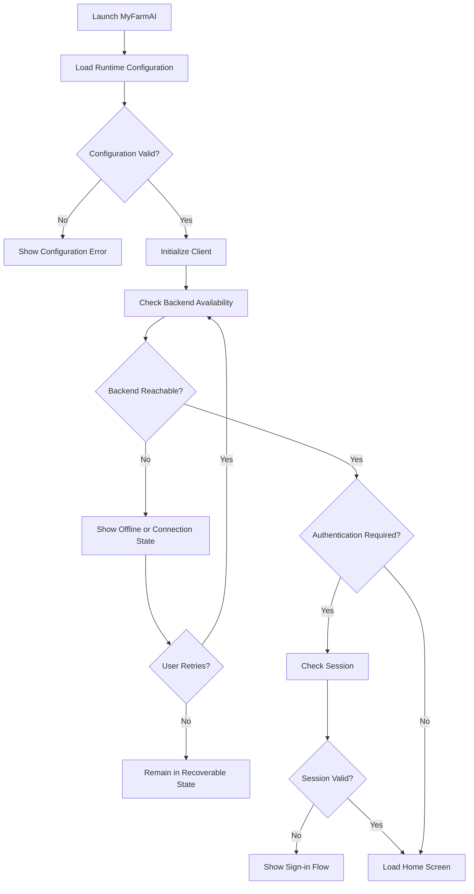

# MyFarmAI — Application Entry Flow

**Document ID:** MYFARMAI-FLOW-001  
**Version:** 1.0  
**Status:** Draft — Owner Review Required  
**Related documents:** `PRD.md`, `TRD.md`, `APP_FLOW.md`, approved SRS and ADRs

## 1. Purpose

Define how MyFarmAI initializes, checks service availability, and routes users to the main application experience on web and Android.

This document describes the intended flow. Existing repository behavior and approved requirements take precedence. It does not authorize new features or restricted changes.

## 2. Entry Flow

## 3. Detailed Steps

1. Load the environment-specific configuration.
2. Validate required non-secret configuration values.
3. Initialize the client and required local state.
4. Check backend availability using the approved health endpoint.
5. If unavailable, show a recoverable state and allow a bounded retry.
6. If authentication is approved and required, validate the current session.
7. Route the user to sign-in or the home screen as appropriate.
8. Load only the approved navigation items and capabilities.

## 4. States and Expected Behavior

| State | Expected behavior |
|---|---|
| Initializing | Show a neutral loading state; avoid duplicate initialization |
| Invalid configuration | Show a safe, actionable error without exposing secrets |
| Backend unavailable | Explain that the service cannot currently be reached |
| Checking session | Avoid briefly displaying protected content |
| Session expired | Route through the approved authentication flow |
| Ready | Show the approved home screen |
| Retry exhausted | Keep the UI usable and provide an explicit retry action |

## 5. Requirements

- Use environment-specific API base URLs.
- Do not assume `localhost` is reachable from a physical Android device.
- Distinguish client startup from backend readiness.
- Do not report a backend as healthy based only on client initialization.
- Keep retry behavior bounded and prevent repeated requests from accumulating.
- Preserve user input where safe when connectivity fails.
- Do not expose internal stack traces, secrets, or service credentials.
- Authentication behavior is conditional on an approved account requirement.

## 6. Acceptance Criteria

- Valid configuration leads to the approved startup flow.
- Invalid configuration produces a safe error state.
- Backend unavailability is visible and recoverable.
- The app does not display protected content before authorization.
- Retry does not create duplicate side effects.
- Web and Android use the correct environment configuration.
- Tests cover startup success, configuration failure, service failure, and session handling where applicable.

## 7. Governance Notes

- Inspect the current routes and startup implementation before changing them.
- Do not create duplicate routes or configuration files without checking the repository.
- Do not change databases, secrets, or production services as part of this flow.
- Mark unimplemented or unverified behavior explicitly.

**Status:** Draft — Owner Review Required.
