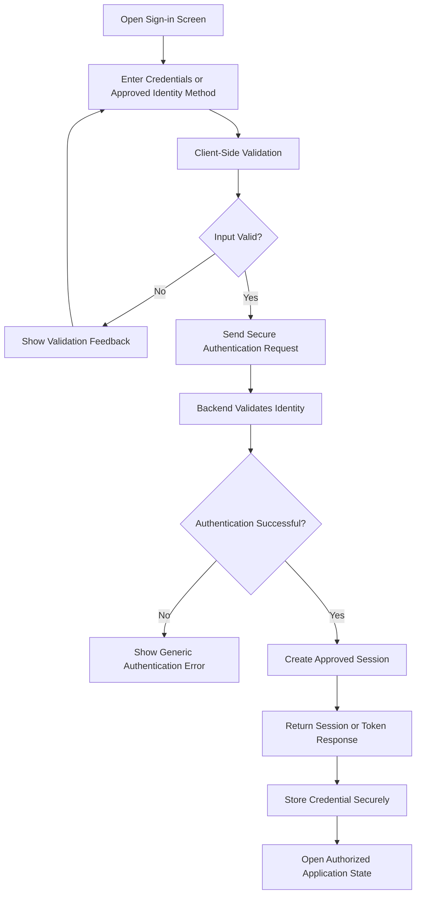
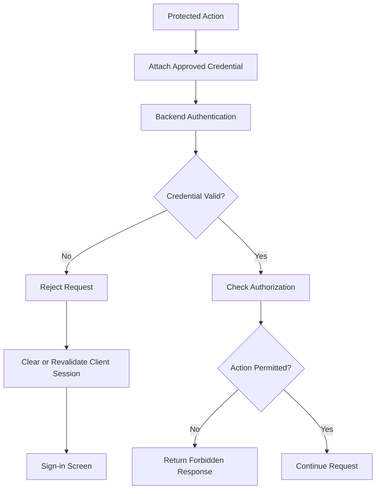

# MyFarmAI — Authentication Flow

**Document ID:** MYFARMAI-FLOW-004  
**Version:** 1.0  
**Status:** Conditional Draft — Owner Review Required  
**Related documents:** `PRD.md`, `TRD.md`, `APP_FLOW.md`, approved SRS and ADRs

## 1. Scope and Approval Gate

This document describes a proposed authentication flow only if MyFarmAI's approved scope requires user accounts.

The existence of this document does not confirm that authentication has been implemented or authorize introducing a new identity system. The selected authentication approach, session model, account recovery policy, and database implications must be approved before implementation.

## 2. Sign-In Flow

## 3. Sign-In Requirements

- Use the authentication method approved for the product.
- Transmit credentials only over HTTPS in deployed environments.
- Validate credentials on the server.
- Return generic errors that do not unnecessarily reveal account existence.
- Apply rate limits and abuse protections.
- Do not log passwords, tokens, or recovery secrets.
- Apply secure password hashing if password authentication is selected.
- Protect sessions against theft, replay, and unauthorized reuse.
- Keep credentials out of URLs and analytics events.

## 4. Session Validation Flow

Authentication proves identity; authorization determines whether that identity may perform the requested action. Both must be enforced on the backend.

## 5. Sign-Out Flow

1. User requests sign-out.
2. Client calls the approved logout endpoint when server-side invalidation is supported.
3. Backend invalidates the relevant session or refresh token.
4. Client clears locally stored credentials.
5. Client removes protected in-memory state where appropriate.
6. Client returns to the public or signed-out screen.

If the chosen authentication protocol is stateless, document the actual revocation strategy rather than claiming that a token has been invalidated when it has not.

## 6. Account Recovery

Account recovery is optional and must be explicitly scoped. If implemented, it must use verified recovery channels, time-limited single-use tokens, rate limiting, and safe responses that avoid exposing account existence.

Recovery tokens must be stored and handled securely. Password changes should invalidate or rotate relevant sessions according to the approved policy.

## 7. Web and Android Considerations

### Web
- Prefer secure, HttpOnly, appropriately configured cookies when the approved session design uses cookie-based authentication.
- Apply CSRF protections where applicable.
- Configure SameSite and Secure attributes according to deployment requirements.
- Do not expose privileged secrets in browser bundles.

### Android
- Use platform-appropriate secure storage for credentials.
- Do not store tokens in plain-text files or ordinary application logs.
- Clear credentials on sign-out.
- Handle revoked and expired sessions safely.
- Do not embed backend administrative credentials in the application.

## 8. Roles and Authorization

If roles are approved, define them in an authorization specification before implementation. Candidate roles may include ordinary user and administrator, but the final role model must not be inferred from this draft.

Every protected operation must enforce permission checks on the backend. UI visibility alone is not an authorization mechanism.

## 9. Security Tests

- Invalid credentials are rejected.
- Expired and revoked credentials are rejected.
- Unauthorized users cannot access protected resources.
- Users cannot access another user's private records by changing identifiers.
- Rate limiting works for authentication endpoints.
- Tokens and passwords do not appear in logs.
- Sign-out and recovery behavior match the chosen protocol.
- Browser session protections are tested where applicable.
- Android credential storage follows the approved security design.

## 10. Acceptance Criteria

- The authentication mechanism is documented and approved.
- Session lifecycle behavior is specified.
- Authentication and authorization are tested independently.
- Web and Android clients handle expiry and sign-out correctly.
- Sensitive values are protected in transit, storage, and logs.
- Recovery behavior, if in scope, is tested.
- Documentation matches the actual implementation.

## 11. Governance Notes

- Confirm whether accounts are required before implementing this flow.
- Review the existing authentication code and ADRs before changing identity or session behavior.
- Database changes require the appropriate approval.
- Do not add an external identity provider or paid service without approval.
- Do not claim authentication is production-ready until security tests and session lifecycle verification pass.

**Status:** Conditional Draft — Owner Review Required.
