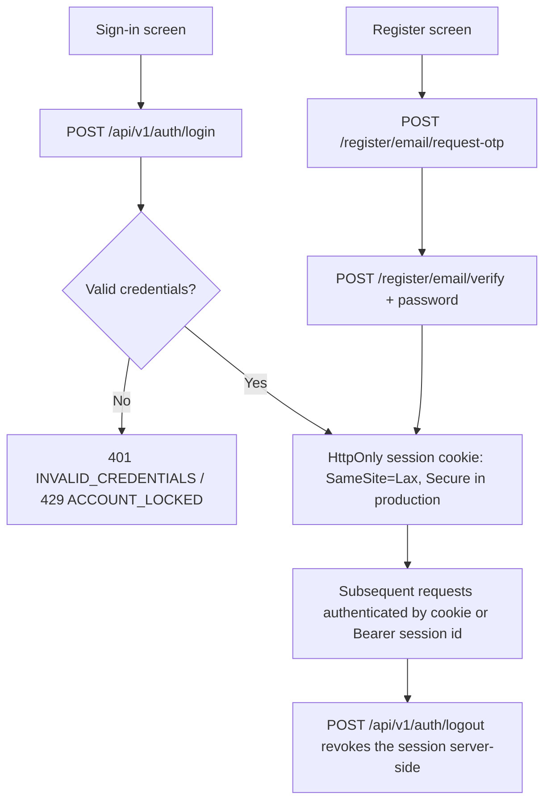

# MyFarmAI — Authentication Flow

**Document ID:** MYFARMAI-FLOW-004  
**Version:** 2.1  
**Status:** Implemented (Phase 3 per ADR-008; public email-OTP registration added by E1, reconciled with password login 2026-11-11) — verified by test suite and Phase 3 exit-gate review  
**Related documents:** `PRD.md`, `TRD.md`, `ADR-008`, `AUTHZ_MATRIX.md`, `docs/api/openapi.json`

## 1. Scope

Describes the **implemented** authentication behavior. ADR-008 defined the MVP baseline (admin-created accounts, opaque session tokens, Android refresh-token rotation). E1 added public **email-OTP registration**; since 2026-11-11 that flow also sets the account password, so a self-registered user can sign in on the web after logout and on Android (audit finding MFAI-022).

## 2. Account Model

- Accounts can be created two ways:
  - **Administrator** via `POST /api/v1/auth/admin/users` (admin-role session required).
  - **Self-registration** via `POST /api/v1/auth/register/email/request-otp` → `POST /api/v1/auth/register/email/verify`.
- Self-registration is email-OTP based and **requires a password** (8–128 chars) at verification. Email control is proven by the code, so the same flow doubles as a password reset for accounts created before passwords were required.
- OTP delivery depends on `EMAIL_DELIVERY_MODE`; `dev` writes the code to the server-side outbox and sends nothing, so public registration is only usable once a real email provider is configured.
- Passwords are hashed with **Argon2id**; verification cost ~114 ms by design. Rehash-on-login upgrades weak parameters transparently.
- Generic error `INVALID_CREDENTIALS` (401) for both unknown-email and wrong-password — no account enumeration.

## 3. Web Flow (Opaque Session Cookie)

- Session id: 256-bit random opaque token; only its SHA-256 hash is stored (`sessions.session_id_hash`).
- TTL from `session_ttl_hours`; expired sessions are rejected (401) and cleaned up.
- Browser storage exposure is eliminated — the cookie is HttpOnly.

## 4. Android Flow (Bearer + Refresh Rotation)

1. `POST /api/v1/auth/login` with `android: true` in the body → access session id (bearer token) **plus** a single-use refresh token.
2. API calls: `Authorization: Bearer <session_id>`.
3. Rotation: `POST /api/v1/auth/token/refresh` consumes the refresh token and issues a new one (old token marked revoked).
4. **Reuse detection:** presenting an already-revoked refresh token revokes the entire chain **and all of the user's sessions** (suspected theft), emits `REFRESH_TOKEN_REVOKED` audit event, and returns 401.

## 5. Protections (Phase 3 hardening)

| Protection | Behavior |
|---|---|
| Rate limiting (per IP) | Global limit from settings; stricter limit (10 req/min/IP) on `/api/v1/auth/*`. Exceeded → 429 `RATE_LIMIT_EXCEEDED` + `Retry-After` |
| X-Forwarded-For spoofing | Forwarded headers honored **only** when the socket peer is a configured trusted proxy (`trusted_proxy_cidrs`); otherwise the peer address is authoritative (Phase 0 finding closed) |
| Account lockout | 5 failed logins per email / 15 min → 429 `ACCOUNT_LOCKED` + `Retry-After: 900`; checked before any DB work; cleared on success |
| CSRF / Origin | Unsafe requests carrying the session cookie with a present-but-disallowed `Origin`/`Referer` → 403 `CSRF_ORIGIN_REJECTED`. Absent Origin is permitted (layered on SameSite=Lax; same-origin browsers always send Origin; bearer clients carry no cookie) |
| Audit events | `LOGIN_SUCCESS`, `LOGIN_FAILED`, `LOGOUT`, `REFRESH_TOKEN_REVOKED` (incl. reuse revocation), `ACCOUNT_CREATED` — no passwords/tokens/hashes in payloads |

## 6. Errors

| Condition | Status | `error_code` |
|---|---|---|
| Bad credentials / expired / revoked session | 401 | `INVALID_CREDENTIALS` / `UNAUTHORIZED` |
| Account locked | 429 | `ACCOUNT_LOCKED` |
| Rate limit exceeded | 429 | `RATE_LIMIT_EXCEEDED` |
| Cross-origin cookie request | 403 | `CSRF_ORIGIN_REJECTED` |

Note: middleware error bodies are flat `{"detail": ..., "error_code": ...}`; endpoint `HTTPException` bodies nest as `{"detail": {"detail": ..., "error_code": ...}}`. Known inconsistency, tracked for normalization.

## 7. Legacy Data

Pre-authentication rows owned by the sentinel user `00000000-0000-0000-0000-000000000000` are **not** readable or reassignable by real users; chat creation always attributes the real authenticated user. Re-assignment of legacy rows is a separate owner decision.

## 8. Out of Scope (current)

MFA, OAuth/SSO provider configuration, and a dedicated "forgot password" screen. Public registration and email verification are implemented; the OTP verify flow can reset a password because it proves email control. Android has **no** registration screen — users register on the web (or are admin-created) and sign in with email+password.
