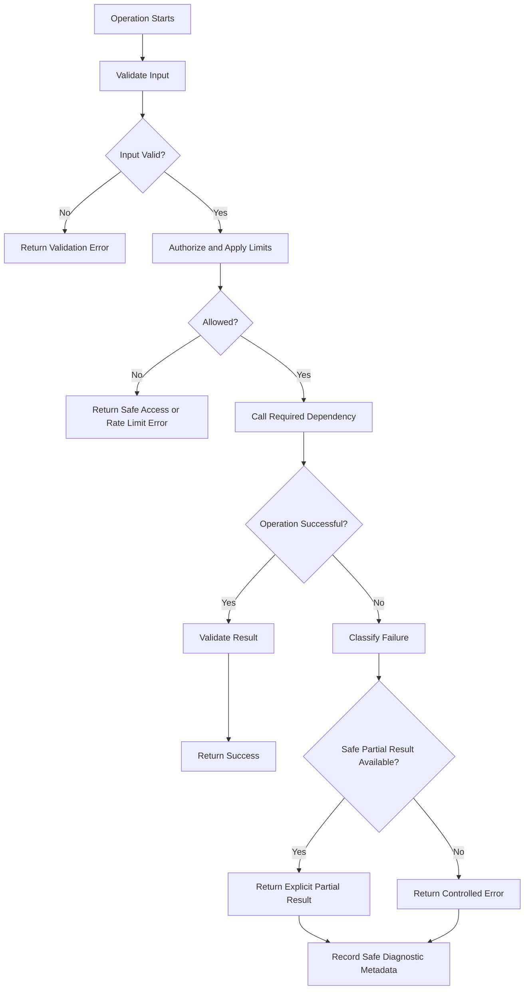

# MyFarmAI — Error and Recovery Flow

**Document ID:** MYFARMAI-FLOW-005  
**Version:** 1.0  
**Status:** Draft — Owner Review Required  
**Related documents:** `PRD.md`, `TRD.md`, `APP_FLOW.md`, approved SRS and ADRs

## 1. Purpose

Define consistent behavior for errors and recoverable failures across the MyFarmAI web client, Android client, API, AI provider, research engine, and persistence layer.

The aim is to make failures understandable to users while preserving diagnostic information for authorized operators.

## 2. Error Handling Flow



## 3. Error Categories

| Category | Examples | Expected response |
|---|---|---|
| Client validation | Missing question, invalid parameter | Explain how to correct the request |
| Authentication | Missing, expired, or invalid credential | Request authentication when applicable |
| Authorization | Insufficient permission | Deny the operation safely |
| Rate limiting | Too many requests | Provide a controlled rate-limit response |
| Network | DNS failure, connection failure | Explain service unavailability |
| Timeout | AI or retrieval deadline exceeded | Report timeout; do not imply success |
| Provider failure | Ollama or SearXNG unavailable | Return a controlled error or valid partial result |
| Persistence | Database unavailable or transaction failure | Avoid exposing database internals |
| Source failure | Blocked page or extraction error | Mark source retrieval as failed |
| Unexpected internal error | Unhandled exception | Return generic error and correlation ID |

## 4. API Error Contract

Proposed error shape:

```json
{
  "error": {
    "code": "DEPENDENCY_UNAVAILABLE",
    "message": "The requested service is temporarily unavailable.",
    "request_id": "server-generated-correlation-id",
    "details": []
  }
}
```

The final contract must align with existing API conventions and approved API documentation.

Requirements:
- Use consistent machine-readable error codes.
- Use suitable HTTP status codes.
- Do not expose stack traces, secrets, filesystem paths, SQL statements, or internal hostnames to clients.
- Provide a request identifier when available.
- Keep detailed diagnostic data in appropriately protected server logs.

## 5. Client Recovery Behavior

### Web and Android
- Preserve user-entered text when safe.
- Show a clear explanation of the failure.
- Offer retry only when retry is appropriate.
- Avoid creating duplicate submissions.
- Indicate when a result is partial.
- Do not label stale data as current.
- Respect cancellation and timeout behavior when supported.

### Retry rules
- Use bounded retries with backoff for transient, safe-to-repeat operations.
- Do not retry validation or authorization failures automatically.
- Do not blindly retry non-idempotent operations.
- Use idempotency keys where duplicate side effects are possible and the API supports them.
- Avoid synchronized retry storms across clients.

## 6. Dependency-Specific Recovery

### Backend unavailable
Show a connection state and allow manual retry. The client must not report a successful operation.

### AI provider unavailable
Return a controlled provider error. Do not silently transmit the prompt to an unapproved external model.

**Degraded-mode contract (P4-02, implemented):** when local inference is saturated or unreachable, the API responds with explicit error codes — `503 AI_BUSY` (queue depth exceeded, `ai_max_queue_depth`), `503 OLLAMA_CONNECTION_FAILED` / `MODEL_NOT_FOUND`, or `504 OLLAMA_TIMEOUT`. The persisted assistant-side error message ("I'm unable to reach the AI service right now.") keeps the conversation coherent; there is **no automatic fallback to a paid provider**. Client-disconnect cancellation propagates via asyncio task cancellation into the in-flight gateway call.

### Research provider unavailable
Return an explicit failure or a clearly labeled partial result if valid evidence is available.

### Database failure
Roll back failed transactions where applicable. Do not silently switch to a different database file or create an alternative canonical database.

### Unsafe or unavailable source
Block prohibited destinations, record a safe failure category, and continue only when the research policy permits partial results.

### Authentication failure
Reject protected requests. Clear or revalidate client session state according to the approved authentication design.

## 7. Observability and Diagnostics

Record safe diagnostic fields such as:
- Timestamp and severity.
- Request correlation identifier.
- Service and operation.
- Error category.
- Dependency name.
- Duration and retry count.
- Whether the operation returned a partial result.

Do not log:
- Passwords or access tokens.
- Secret values.
- Unnecessary personal information.
- Full private prompts by default.
- Sensitive database contents.

Diagnostic access must follow the approved operational access policy.

## 8. Recovery and Data Integrity

- Use database transactions for related writes.
- Avoid partial writes when an operation requires atomicity.
- Do not delete or reset data to recover from an error.
- Do not change database locations automatically.
- Preserve error evidence before attempting remediation.
- Require owner approval for destructive recovery operations.
- Follow the verified backup and recovery procedure for data restoration.

A backup must not be called verified until a controlled restoration test has succeeded.

## 9. Testing Requirements

Test at least:
1. Invalid input.
2. Unauthorized and forbidden requests.
3. Rate-limit responses.
4. Connection refusal.
5. Provider timeout.
6. Malformed provider response.
7. Partial research results.
8. Database transaction rollback.
9. Duplicate submission and retry handling.
10. Client disconnect and cancellation, where supported.
11. Safe handling of unexpected exceptions.
12. Logging redaction.
13. Recovery from a dependency becoming available again.

## 10. Acceptance Criteria

- Errors have consistent response structures.
- Client messages are safe and understandable.
- Internal implementation details are not exposed.
- Transient failures do not cause uncontrolled retry loops.
- Partial results are distinguishable from full success.
- Data integrity is preserved during failures.
- Logs contain useful, non-sensitive diagnostics.
- Recovery behavior is tested and documented.

## 11. Governance Notes

- Do not run destructive database recovery or Docker operations without explicit approval.
- Do not rotate secrets or restart/change the voice service without approval.
- Do not silently replace a configured provider or database.
- Record unresolved operational risks.
- Update this document when error contracts or recovery behavior change.

**Status:** Draft — Owner Review Required.
