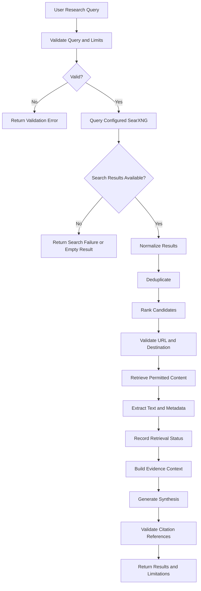

# MyFarmAI — Research Flow

**Document ID:** MYFARMAI-FLOW-003  
**Version:** 1.0  
**Status:** Draft — Owner Review Required  
**Related documents:** `PRD.md`, `TRD.md`, `APP_FLOW.md`, approved SRS and ADRs

## 1. Purpose

Define the research lifecycle for discovering, retrieving, evaluating, and synthesizing online information for MyFarmAI.

SearXNG is the proposed metasearch component. The actual provider configuration and available integrations must be confirmed in the repository.

## 2. End-to-End Flow



## 3. Processing Stages

### Stage 1 — Query validation
- Enforce maximum query length and supported parameters.
- Normalize input without changing its intended meaning.
- Apply authentication and rate limits where required.

### Stage 2 — Search
- Query configured SearXNG endpoints.
- Apply a timeout and bounded result count.
- Record provider failures without exposing credentials.
- Do not claim that all available sources were searched if the provider returns partial results.

### Stage 3 — Normalize and deduplicate
- Normalize result fields.
- Deduplicate by canonical URL or other documented rules.
- Preserve source provenance.
- Do not invent missing metadata.

### Stage 4 — Rank
- Use documented relevance criteria.
- Make ranking behavior testable.
- Avoid treating search rank as proof of factual correctness.

### Stage 5 — URL and destination validation
- Permit only approved URL schemes, normally HTTP and HTTPS.
- Reject loopback, private, link-local, reserved, and disallowed destinations.
- Revalidate resolved IP addresses at connection time.
- Revalidate every redirect destination.
- Apply network egress restrictions where feasible.

### Stage 6 — Retrieve content
- Enforce connection and total timeouts.
- Limit response size and supported content types.
- Do not execute scripts or active content.
- Record blocked, failed, and timed-out retrievals accurately.
- Respect source access restrictions and applicable terms.

### Stage 7 — Extract content
- Extract useful text and available metadata.
- Bound extracted text length.
- Treat page content as untrusted.
- Do not execute downloaded files or treat retrieved instructions as privileged commands.

### Stage 8 — Synthesis
- Provide the model with bounded evidence and explicit untrusted-content boundaries.
- Preserve links between evidence passages and source records.
- Communicate uncertainty and conflicting evidence when identified.
- Do not claim source support for statements not grounded in the retrieved material.

### Stage 9 — Citation validation
- Ensure each citation maps to a real source record.
- Preserve canonical URL and retrieval status.
- Omit unknown publication dates rather than inventing them.
- Reject or flag malformed citations.

### Stage 10 — Response
- Return the synthesis, verified source metadata, limitations, and request identifier.
- Clearly distinguish full results, partial results, and failure.

## 4. Suggested Source Record

The following is a conceptual data contract; it is not an instruction to create a database table before schema approval.

```json
{
  "title": "Verified source title when available",
  "url": "https://source.example/path",
  "domain": "source.example",
  "retrieved_at": "ISO-8601 timestamp",
  "published_at": null,
  "retrieval_status": "success"
}
```

The example domain is illustrative only. Actual source records must reflect real retrieval outcomes.

## 5. Failure Modes

| Failure | Required behavior |
|---|---|
| SearXNG unavailable | Return a controlled failure or approved fallback |
| No results | Return an empty-result state |
| Duplicate sources | Deduplicate using documented rules |
| Unsafe URL | Block retrieval and record the reason safely |
| Redirect to prohibited destination | Stop retrieval |
| Timeout | Mark the source as timed out |
| Oversized response | Stop retrieval at the configured limit |
| Unsupported content type | Skip or reject the source |
| Extraction failure | Retain failure status; do not claim content was analyzed |
| AI synthesis failure | Return a controlled failure or approved partial result |
| Invalid citation | Reject or omit it according to the response contract |

## 6. Security Requirements

Research is an untrusted network boundary. URL parsing alone is not sufficient SSRF protection. The implementation must account for DNS rebinding, redirects, private IP ranges, proxy behavior, and internal network access.

Retrieved text must not be allowed to authorize tool calls, change system instructions, expose secrets, or bypass access controls.

## 7. Observability

Record safe operational metadata such as:

- Request correlation ID.
- Search provider status.
- Number of candidate sources.
- Number of successful, blocked, and failed retrievals.
- Stage duration.
- Error category.
- Whether the result was partial.

Do not log credentials, full sensitive prompts, or unnecessary personal content.

## 8. Acceptance Criteria

- Search provider failures are handled predictably.
- Candidate URLs are validated before retrieval.
- Redirects and resolved destinations are checked.
- Timeouts and response-size limits are enforced.
- Source metadata reflects actual retrieval outcomes.
- Citations map to real source records.
- Partial research is clearly identified.
- Security tests cover SSRF, redirects, DNS changes, and size limits.

## 9. Governance Notes

- Verify current SearXNG configuration and secret handling before changes.
- Secret rotation remains plan-only until separately approved.
- Do not change production service configuration without approval.
- Do not add paid search or model providers without owner approval.
- Update the flow and tests whenever retrieval behavior changes.

**Status:** Draft — Owner Review Required.
